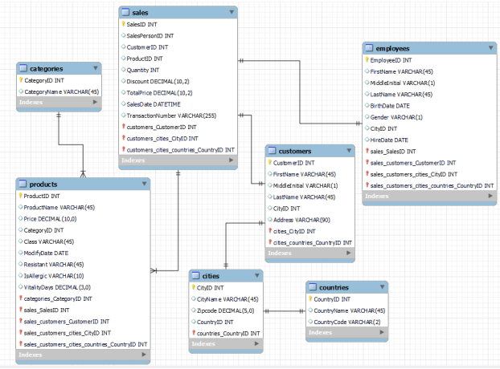
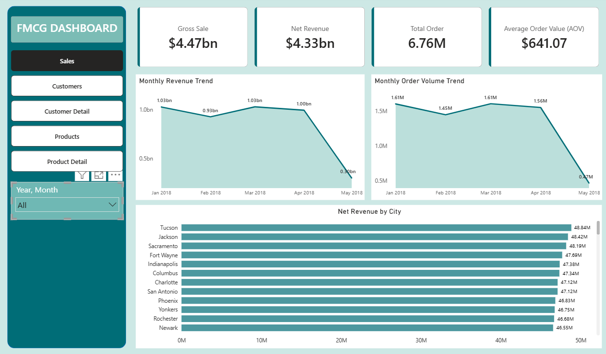
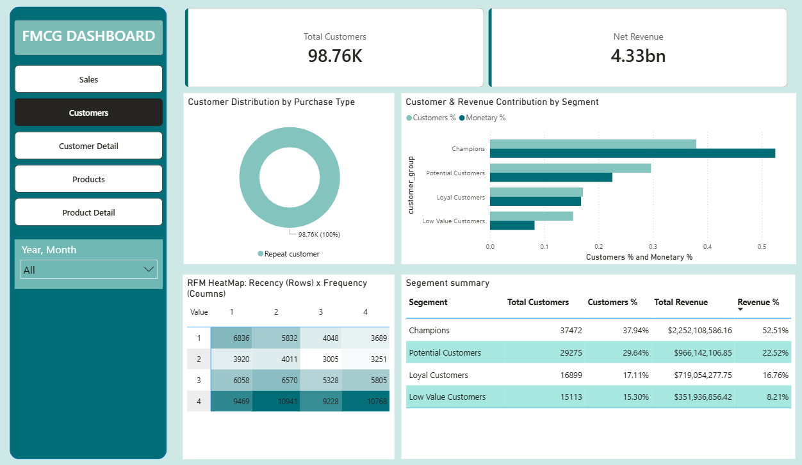
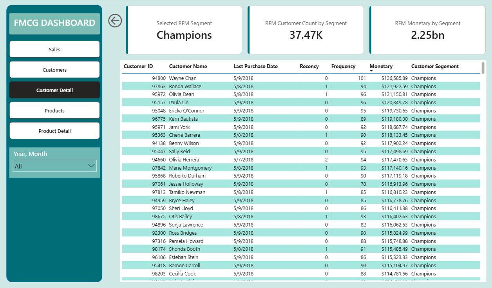
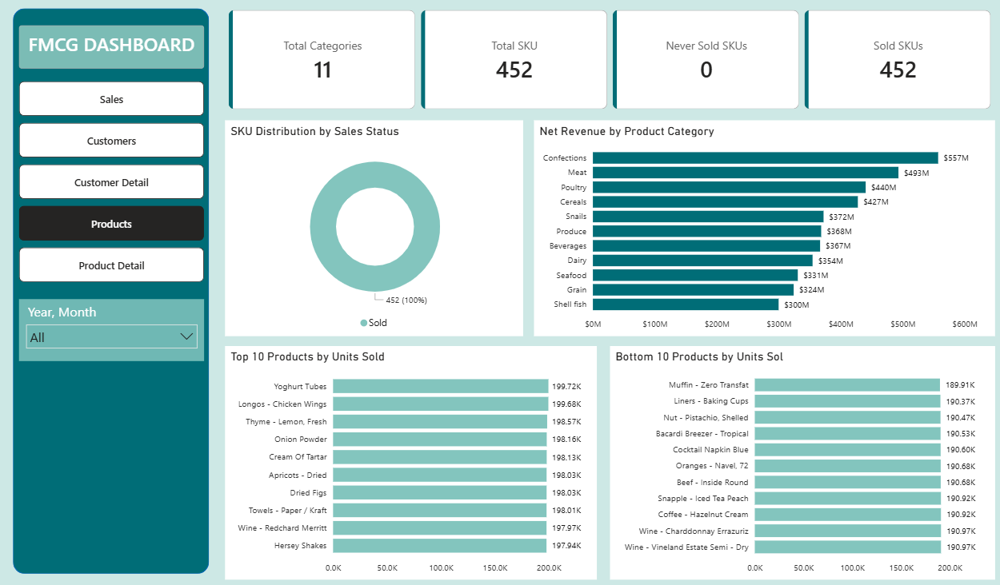
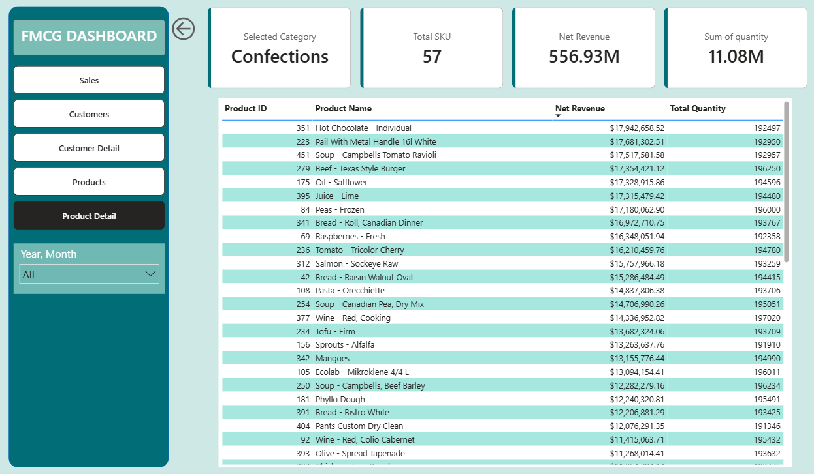

# FMCG Sales Dashboard

> Dashboard Power BI phân tích **~6.76 triệu giao dịch** của chuỗi siêu thị FMCG **Xóm Mart** (01/01/2018 – 09/05/2018), tập trung vào 3 bài toán: **Sales Performance**, **Customer Analytics (RFM)** và **Product Performance**. Các truy vấn T-SQL được dùng để đối soát độc lập với số liệu trên Power BI.

https://github.com/user-attachments/assets/d90a84b6-d824-4ed7-aa9b-45590bdfd1aa

## Tóm tắt kết quả

**Bối cảnh:** Xóm Mart là chuỗi bán lẻ FMCG đa quốc gia (452 SKU, 11 ngành hàng, gần 100.000 khách hàng thẻ thành viên). Ban lãnh đạo cần trả lời 3 câu hỏi: *(1) Doanh thu đang tăng hay giảm, động lực đến từ đâu? (2) Khách hàng nào tạo ra nhiều giá trị nhất? (3) SKU và ngành hàng nào hiệu quả, có SKU "zombie" hay không?*

| Chỉ số | Giá trị |
|---|---|
| Gross Sale (trước giảm giá) | 4.47 tỷ USD |
| Net Revenue (sau giảm giá) | 4.33 tỷ USD |
| Giảm giá | ≈ 0.14 tỷ USD (≈ 3.1% Gross Sale) |
| Tổng số đơn hàng | 6.76 triệu |
| AOV (giá trị đơn trung bình) | 641.07 USD |
| Khách hàng có giao dịch | 98.76 nghìn |
| SKU (đã bán / tổng) | 452 / 452 |

### Phát hiện chính

#### 1. Sales: "biến động" theo tháng thực chất là hiệu ứng lịch, doanh thu bình quân ngày gần như đi ngang

| Tháng | Doanh thu | Số đơn | Số ngày | Doanh thu / ngày | Đơn / ngày | MoM |
|---|---|---|---|---|---|---|
| 01/2018 | 1.03 tỷ | 1.61M | 31 | ≈ 33.2M | ≈ 51.9K | – |
| 02/2018 | 0.93 tỷ | 1.45M | 28 | ≈ 33.2M | ≈ 51.8K | −9.7% |
| 03/2018 | 1.03 tỷ | 1.61M | 31 | ≈ 33.2M | ≈ 51.9K | +10.8% |
| 04/2018 | 1.00 tỷ | 1.56M | 30 | ≈ 33.3M | ≈ 52.0K | −2.9% |
| 05/2018 (01–09/05) | 0.30 tỷ | 0.47M | 9 | ≈ 33.3M | ≈ 52.2K | không so sánh được |

*(Tính từ các số liệu đã làm tròn hiển thị trên dashboard, đơn vị USD.)*

- Tháng 2 "sụt" gần 10% chỉ vì có 28 ngày; tháng 3 "hồi phục" vì có 31 ngày. Tháng 5 chỉ có 9 ngày dữ liệu nên **không phải dấu hiệu suy giảm**.
- Doanh thu và số đơn bình quân mỗi ngày gần như không đổi (~33 triệu USD và ~52 nghìn đơn/ngày) → doanh nghiệp **ổn định nhưng chưa tăng trưởng**. Tháng 1 và tháng 3 là hai tháng doanh thu cao nhất (~1.03 tỷ USD) do cùng có 31 ngày.
- Giảm giá chiếm ≈ 3.1% Gross Sale (~140 triệu USD), mức khá thấp và đều.

#### 2. Geographic: doanh thu phân bố rất đều giữa các thành phố

- Top 5 thành phố: **Tucson (48.84M), Jackson (48.42M), Sacramento (48.19M), Fort Wayne (47.69M), Indianapolis (47.38M)**.
- Chênh lệch giữa thành phố số 1 và số 12 (Newark, 46.55M) chỉ ≈ 4.9%; mỗi thành phố trong top chỉ đóng góp ≈ 1.1% tổng doanh thu → **không có thị trường nào vượt trội rõ rệt**, nên việc ưu tiên thành phố cần thêm dữ liệu về chi phí và độ phủ.

#### 3. Customer (RFM): nhóm Champions tạo ra hơn một nửa doanh thu

| Nhóm | Số khách | % khách | Doanh thu (USD) | % doanh thu |
|---|---|---|---|---|
| Champions | 37,472 | 37.94% | 2,252,108,586 | 52.51% | 
| Potential Customers | 29,275 | 29.64% | 966,142,107 | 22.52% |
| Loyal Customers | 16,899 | 17.11% | 719,054,278 | 16.76% |
| Low Value Customers | 15,113 | 15.30% | 351,936,856 | 8.21% |

- **Champions** chiếm 37.94% khách nhưng tạo **52.51% doanh thu**; giá trị mỗi khách gấp ≈ 2.6 lần nhóm Low Value.
- **Potential Customers** là nhóm đông thứ hai nhưng chỉ đóng góp **22.52% doanh thu**; trong khi **Loyal Customers** (ít khách hơn) có giá trị mỗi khách cao hơn Potential ≈ 29% → đây là nhóm có dư địa nâng cấp rõ nhất.
- **Low Value Customers** chiếm 15.30% khách nhưng chỉ 8.21% doanh thu.
- Biểu đồ phân loại *One-time vs Repeat* cho kết quả **100% khách là Repeat** nên không có giá trị phân biệt, vì vậy RFM là công cụ phân khúc chính.

#### 4. Product: không có SKU "zombie", chênh lệch doanh thu đến từ giá hơn là sản lượng

- **0/452 SKU chưa từng bán** → giả thuyết "~20% SKU zombie" trong brief **không đúng** với dữ liệu 4 tháng này.
- Sản lượng giữa các SKU gần như đồng đều: Top 10 bán chạy nhất đạt 197.9K – 199.7K đơn vị, Bottom 10 đạt 189.9K – 191.0K đơn vị (chênh ≈ 5%). Xếp hạng theo sản lượng vì vậy ít giá trị quyết định; **doanh thu theo SKU khác nhau chủ yếu do giá bán**.
- Top 3 ngành hàng: **Confections (557M), Meat (493M), Poultry (440M)** = ≈ 34% doanh thu; ngành thấp nhất là Shell fish (300M). Chênh lệch giữa ngành cao nhất và thấp nhất ≈ 1.86 lần.
- Confections có 57/452 SKU (≈ 12.6%) và chiếm ≈ 12.85% doanh thu → vị trí dẫn đầu nhiều khả năng đến từ **số lượng SKU lớn hơn**, doanh thu mỗi SKU xấp xỉ mức trung bình (≈ 9.8M so với 9.6M).

### Đề xuất hành động

| Ưu tiên | Hành động | KPI theo dõi |
|---|---|---|
| **Giữ chân Champions** | Chương trình ưu đãi hội viên cao cấp, chăm sóc riêng; thiết lập cảnh báo khi recency của khách Champions tăng. | Tỷ lệ Champions giữ nguyên nhóm, doanh thu/khách |
| **Potential → tăng tần suất** | Ưu đãi theo số lần mua, combo/cross-sell, nhắc mua lại. | Tần suất mua, doanh thu/khách |
| **Loyal → mua lại đều đặn** | Duy trì nhịp mua bằng ưu đãi mua lại, gợi ý sản phẩm theo lịch sử mua | Tỷ lệ chuyển lên Champions |
| **Low Value → tìm nguyên nhân, kích hoạt thử nghiệm** | Khảo sát/phân tích giỏ hàng để tìm nguyên nhân; thử nghiệm quy mô nhỏ. | Tỷ lệ kích hoạt lại, ROI chiến dịch |
| **Thành phố ưu tiên** | Dùng nhóm thành phố dẫn đầu (Tucson, Jackson, Sacramento…) làm điểm thử nghiệm chương trình khuyến mãi/CRM; vì chênh lệch nhỏ | Doanh thu/khách theo thành phố |
| **Tối ưu giảm giá** | Giảm giá đang ≈ 3.1% doanh thu gộp; thử nghiệm A/B mức giảm theo ngành hàng thay vì áp đồng loạt | Net revenue/Gross sale theo ngành |
| **Danh mục sản phẩm** | Không cần loại bỏ SKU; tập trung tối ưu giá và cơ cấu. Đẩy mạnh ngành doanh thu cao; theo brief, **Meat/Poultry có biên cao** (cần kiểm soát tồn kho do vitality days ngắn), còn **Confections biên thấp** nên tránh giảm giá sâu | Doanh thu/SKU, tỷ trọng ngành |

> Các kịch bản "nâng nhóm" và "mất Champions" chỉ là **ước tính minh hoạ** dựa trên doanh thu trung bình mỗi nhóm, không phải dự báo.

## Dữ liệu

- Nguồn: **FMCG Sales** trên Xóm Dataset: [https://dataset.xomdata.com/datasets/schema/fmcg_sales].
- Phạm vi: snapshot giao dịch từ **01/01/2018 đến 09/05/2018** , ≈ 6.75 triệu dòng bán hàng.
- Quy mô: 452 SKU, 11 ngành hàng, gần 100.000 khách hàng, 200+ thành phố, 23 nhân viên thu ngân.

**Đặc điểm dữ liệu cần lưu ý (từ brief và kiểm tra):**

- Cột `total_price` trong bảng `sales` luôn bằng 0 → không dùng, doanh thu được tính lại.
- `discount` là tỷ lệ phần trăm (dạng thập phân); `quantity` luôn > 0.
- `price` trong bảng `products` là giá tại thời điểm giao dịch.
- Không có giá vốn (COGS) → chỉ phân tích được doanh thu, không phân tích được lợi nhuận.
- Mã quốc gia 2 ký tự là mã nội bộ, không phải ISO 3166.
- `sales_date` có giá trị null (ghi nhận khoảng 10%).

### Các bước làm sạch (Power Query)

1. Import các bảng từ schema `fmcg_sales`, chuẩn hoá kiểu dữ liệu (ngày, số, văn bản).
2. Bỏ qua `total_price` (toàn 0), tính lại doanh thu từ `quantity`, `price`, `discount`.
3. Tạo cột `Sales Date Only` (chỉ phần ngày) để nối với bảng `Calendar`.
4. Tạo bảng `Calendar` (Date, Month, Month Number, Year, YearMonth).
5. Tạo cột `SKU Status` trong `products` (Sold / Never sold) phục vụ phân tích SKU zombie.
6. Tạo các bảng phụ phục vụ phân khúc khách hàng và trục biểu đồ (`RFM`, `Customer Type`, `R Score Axis`, `F Score Axis`, `RFM Segment Axis`, `Revenue-City`).


## Mô hình dữ liệu (Star Schema)



| Bảng | Vai trò | Quan hệ |
|---|---|---|
| `fmcg_sales sales` | Fact: từng dòng giao dịch | – |
| `fmcg_sales products` | Dim sản phẩm | 1 → * với `sales` (`product_id`) |
| `fmcg_sales categories` | Dim ngành hàng | 1 → * với `products` (`category_id`) |
| `fmcg_sales customers` | Dim khách hàng | 1 → * với `sales` (`customer_id`) |
| `fmcg_sales cities` | Dim thành phố | 1 → * với `customers` (`city_id`) |
| `fmcg_sales countries` | Dim quốc gia | 1 → * với `cities` (`country_id`) |
| `fmcg_sales employees` | Dim nhân viên | 1 → * với `sales` (`salesperson_id`) |
| `Calendar` | Dim thời gian | 1 → * với `sales` (`Sales Date Only`) |
| `RFM`, `Customer Type`, `R/F Score Axis`, `RFM Segment Axis`, `Revenue-City` | Bảng phụ cho visual, không nối với fact | – |

## Phương pháp

### Công thức các chỉ số chính

| Chỉ số | Cách tính |
|---|---|
| Gross Sale | Σ `quantity` × `price` |
| Net Revenue | Σ `quantity` × `price` × (1 − `discount`) |
| Total Order | Số `transaction_number` phân biệt |
| AOV | Net Revenue ÷ Total Order |

### RFM Segmentation

- **Recency (R):** số ngày từ lần mua gần nhất đến ngày cuối của dữ liệu (09/05/2018).
- **Frequency (F):** số giao dịch phân biệt của khách hàng.
- **Monetary (M):** tổng Net Revenue của khách hàng.
- Mỗi chỉ số được chấm điểm **1–4 theo tứ phân vị** (4 là tốt nhất: mua gần đây, mua nhiều, chi tiêu cao); `rfm_score = R + F + M` (3–12).
- Khách hàng được xếp từ điểm cao đến thấp và chia thành 4 nhóm: **Champions → Loyal Customers → Potential Customers → Low Value Customers**.
- Trang *Customers* hiển thị phân bổ khách và doanh thu theo nhóm cùng heatmap Recency × Frequency; trang *Customer Detail* cho phép drill-through xem danh sách khách của từng nhóm.

<!-- TODO: mô tả chính xác quy tắc DAX chia 4 nhóm trên Power BI (ngưỡng điểm hay tỷ lệ phần trăm) -->

### Đối soát bằng SQL

Dashboard tính hoàn toàn bằng Power Query/DAX và **không kết nối SQL**. File `fmcg_sales_sql.sql` (T-SQL) được viết riêng để kiểm chứng độc lập:

| Truy vấn SQL | Đối chiếu với Power BI |
|---|---|
| Tổng doanh thu, số giao dịch, AOV | Các thẻ KPI ở trang Sales |
| Doanh thu theo tháng + doanh thu tích luỹ (window function) | Monthly Revenue Trend |
| Doanh thu theo thành phố | Net Revenue by City |
| Repeat customer vs One-time buyer | Customer Distribution by Purchase Type |
| RFM (NTILE) | Trang Customers / Customer Detail |
| Sản phẩm zombie | SKU Distribution by Sales Status, Never Sold SKUs |
| Ngành hàng + số SKU + doanh thu | Net Revenue by Product Category |
| Top 10 bán chạy / ít nhất | Top / Bottom 10 Products by Units Sold |

## Các trang dashboard
**Sales** : KPI (Gross Sale, Net Revenue, Total Order, AOV), xu hướng doanh thu và số đơn theo tháng, Net Revenue theo thành phố, bộ lọc Year/Month


**Customers**: Tổng khách, phân loại One-time/Repeat, tỷ trọng khách và doanh thu theo phân khúc RFM, heatmap Recency × Frequency, bảng tổng hợp phân khúc


**Customer Detail**: Drill-through danh sách khách theo phân khúc: ngày mua cuối, Recency, Frequency, Monetary
 

**Products**: Số ngành hàng, SKU đã bán/chưa bán, Net Revenue theo ngành hàng, Top/Bottom 10 SKU theo sản lượng


**Product Detail**: Drill-through danh sách SKU theo ngành hàng: doanh thu và sản lượng


## Hạn chế của dữ liệu và phân tích

- **Phạm vi thời gian ngắn:** chỉ ≈ 4 tháng + 9 ngày, tháng 5 chưa đầy đủ, không có dữ liệu cùng kỳ nên không đánh giá được tính mùa vụ hay tăng trưởng YoY.
- **Không có COGS:** các nhận định về biên lợi nhuận (Confections thấp, Meat/Poultry cao) dựa vào brief, chưa kiểm chứng được bằng dữ liệu.
- **RFM:** điểm Recency/Frequency chia theo tứ phân vị tương đối; do tần suất mua rất cao (trung bình ≈ 68 đơn/khách trong 129 ngày) nên nhiều khách có Recency rất gần nhau. Nên xem thêm phân phối số ngày tuyệt đối trước khi diễn giải nhóm "lâu không mua".
- **Địa lý:** doanh thu giữa các thành phố chênh lệch nhỏ; doanh thu đơn thuần chưa đủ để kết luận tiềm năng mở rộng (thiếu chi phí, quy mô thị trường, độ phủ). Mã quốc gia là mã nội bộ.
- **Chưa phân tích:** hiệu suất nhân viên (không có dữ liệu ca làm việc/giờ làm), phân tích cặp sản phẩm hay mua chung.

## Cấu trúc repo

```
Project_fmcg_sales/
├── images/
│   ├── Schema.png
│   ├── sales.png
│   ├── customers.png
│   ├── customer_detail.png
│   ├── products.png
│   └── product_detail.png
├── demo.mp4
├── fmcg_sales_dashboard.pbix
├── fmcg_sales_sql.sql
└── README.md
```

## Cách mở file

- **Dashboard:** mở `fmcg_sales_dashboard.pbix` bằng **Power BI Desktop** (Windows). Nếu báo lỗi nguồn dữ liệu: *Home → Transform data → Data source settings* để cập nhật đường dẫn/kết nối.
- **SQL:** chạy `fmcg_sales_sql.sql` trên **SQL Server / Azure SQL** (cú pháp T-SQL: `DATEFROMPARTS`, `FORMAT`, `TOP`) với schema `fmcg_sales`. Mỗi truy vấn độc lập, có thể chạy riêng từng khối.
- **Demo:** xem `demo.mp4` hoặc video ở đầu trang.

## Kỹ năng thể hiện

- **Power Query & Data Modeling:** làm sạch dữ liệu, xây bảng Calendar, bảng phụ cho visual.
- **DAX:** Net Revenue, AOV, RFM scoring, phân khúc khách hàng.
- **T-SQL:** CTE, window function (`NTILE`, running total), subquery, đối soát số liệu độc lập với Power BI.
- **Phân tích khách hàng:** RFM segmentation, chỉ số đóng góp theo phân khúc.
- **Data validation:** phát hiện lỗi dữ liệu (`total_price = 0`, null ngày), chuẩn hoá theo số ngày, đối soát tổng.
- **Trực quan hoá & storytelling:** dashboard nhiều trang có drill-through, chuyển số liệu thành insight và đề xuất hành động.
